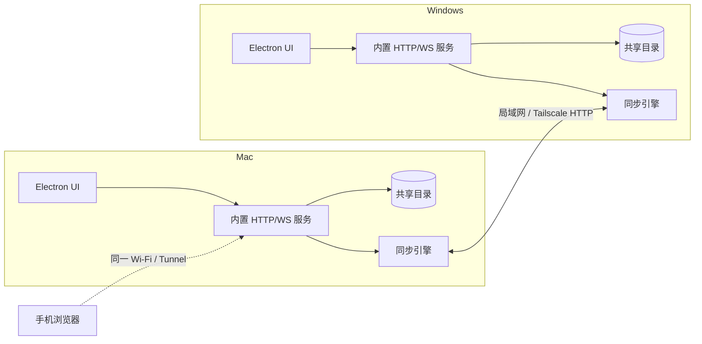

# FileBridge

Mac ↔ Windows 的局域网文件互通工具：共享文件夹自动双向同步、桌面悬浮窗拖拽投递、手机扫码访问、文本剪贴板共享。  
不依赖云服务器；同一局域网直连，异地可配合 Tailscale 或 Cloudflare Tunnel。

> 当前版本：**v1.0.0**（未签名构建，个人/小团队使用）

## 功能

- **双向同步**：两端共享目录的文件新增/修改会自动出现在另一台设备。
- **删除同步（墓碑）**：在应用内删除会双向生效，不会被对端重新拉回。
- **悬浮窗投递**：把文件拖到桌面悬浮窗，选择项目/文件夹后归档并同步。
- **手机访问**：iPhone Safari 扫码即可浏览、下载、上传，无需安装 App。
- **在线预览**：图片、文本/代码、视频、音频、PDF、Office/ZIP 基础预览。
- **跨设备剪贴板**：文字实时同步，支持复制/删除。
- **目录操作**：新建文件夹、重命名、移动、删除、修改共享目录。
- **多种发现方式**：UDP 广播、HTTP 局域网扫描、手动添加、IP 变更自动通告。
- **远程访问**：内置 Cloudflare Tunnel 管理，可绑定自己的域名。

## 架构



- 默认端口：HTTP/WS **47890**，UDP 发现 **47891**（端口被占用时自动 +1）。
- 同步是"拉取镜像 + 墓碑删除"：每轮拉取对端清单，只下载缺失/变更文件；删除通过墓碑传播。
- 冲突策略：同名不同内容保留双方，另一份命名为 `原名 (来自 设备名).扩展名`。

## 快速开始

### 从源码运行

```bash
npm install
npm start          # Electron 桌面模式
npm run server     # 只启动服务，浏览器访问
```

### 安装包

发布页提供以下产物：

| 平台 | 文件 | 说明 |
|---|---|---|
| macOS | `FileBridge-1.0.0.pkg` | 双击自动安装到 `/Applications` |
| macOS | `FileBridge-mac-arm64.dmg` | 打开后拖入 Applications |
| Windows | `FileBridge-Setup-1.0.0.exe` | NSIS 安装器，支持 `/S`、`/D=` |
| Windows | `FileBridge-win-x64.zip` | 免安装，解压双击 `FileBridge.exe` |

> **Windows 安装器固定使用 NSIS 3.04 stub**。NSIS 3.13 的 stub 在 Windows 11 25H2 上启动即 `0xC0000005` 崩溃，请勿升级。  
> 安装器异常时直接使用免安装 zip，功能完全一致。

## 首次使用

1. 打开 App，设置访问口令（两台设备必须一致）。
2. 设置共享目录（默认 `~/FileBridge` / `%USERPROFILE%\FileBridge`，可在设置里更改）。
3. 同一局域网内会自动发现并同步；无法自动发现时：
   - 设置 → 同步设备 → **扫描局域网**
   - 或手动添加 `对方 IP : 47890`
4. 手机与电脑连同一 Wi-Fi，主窗口「手机访问」扫码。
5. 异地使用：两端安装 [Tailscale](https://tailscale.com/download) 并登录同一账号，填 `100.x.x.x:47890`；或配置 Cloudflare Tunnel。

详细步骤见 [docs/getting-started.md](docs/getting-started.md)。

## 删除语义（重要）

- 只有在 **应用内删除**（右键删除 / 工具栏删除 / `POST /api/delete`）才会写墓碑并双向删除。
- 在 Finder / 资源管理器 / PowerShell 直接删除**不会**写墓碑，文件可能被对端重新拉回。
- 墓碑只删除 `mtime <= deletedAt` 的文件；删除后对端又修改/新建的同名文件会保留。
- 删除是永久的，不进回收站。

## 配置与数据

| 平台 | 数据目录 |
|---|---|
| macOS | `~/Library/Application Support/FileBridge/` |
| Windows | `%APPDATA%\FileBridge\` |

文件：

- `config.json`：设备名、共享目录、访问口令、端口、`manualPeers` 等
- `tunnel.json`：Cloudflare Tunnel 配置（token 仅存本机）
- `float-window.json`：悬浮窗位置
- `clipboard.json`：剪贴板历史
- `tombstones.json`：删除墓碑（保留 30 天）

> 升级/重装请保留 `deviceId`，否则对端会把它当成新设备。

## 构建与发布

```bash
npm run pack:mac   # .app + zip + pkg + 样式化 dmg
npm run pack:win   # Setup.exe + 免安装 zip
npm run pack:dmg   # 只重新生成 DMG
```

Windows 安装器跨平台构建依赖：

- electron-builder **26.18.0**
- NSIS bundle **3.0.4.1**（makensis 3.04）
- 不要使用 `nsis@2.0.4` / NSIS 3.13

构建产物不提交到 git，发布时作为 Release 资产上传。

## 文档

- [快速开始](docs/getting-started.md)
- [架构说明](docs/architecture.md)
- [同步协议](docs/sync-protocol.md)
- [API 摘要](docs/API.md)
- [Windows 部署](docs/windows-deployment.md)
- [故障排查](docs/troubleshooting.md)
- [通用演示（占位符）](docs/demo.md)
- [变更记录](CHANGELOG.md)

## 已知限制

- 校园网/企业网常屏蔽 UDP 广播，自动发现可能失败，需 HTTP 扫描或手动添加。
- 删除是永久的，没有回收站。
- 两端同时"一端删、一端写"可能出现短暂的文件忽隐忽现（墓碑竞争）。
- 未签名构建：macOS Gatekeeper、Windows SmartScreen 会提示。
- 免费 Cloudflare Tunnel 速度受线路影响，不适合大文件高速同步。
- 分享链接可能选中虚拟网卡地址（如 VirtualBox Host-Only），手机访问请选 Wi-Fi 地址。

## 安全

- 默认只建议在可信局域网使用；公网暴露必须设置访问口令，并建议叠加 Cloudflare Access。
- 访问口令、Tunnel token 不写入日志、不通过 API 回传。
- 发现、同步、上传均为明文 HTTP（局域网/Tailscale 内），公网请走 HTTPS Tunnel。

## License

[MIT](LICENSE)
