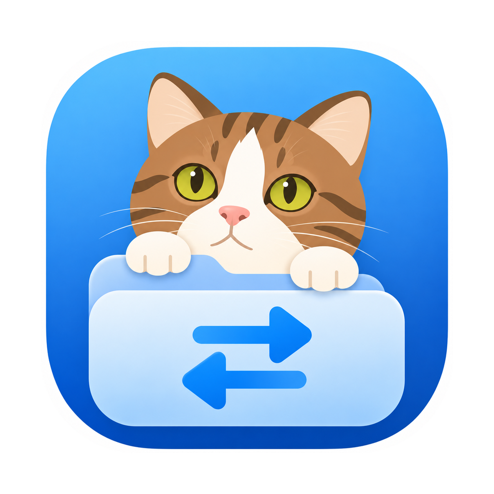
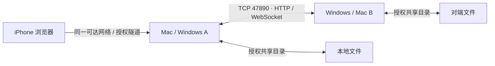
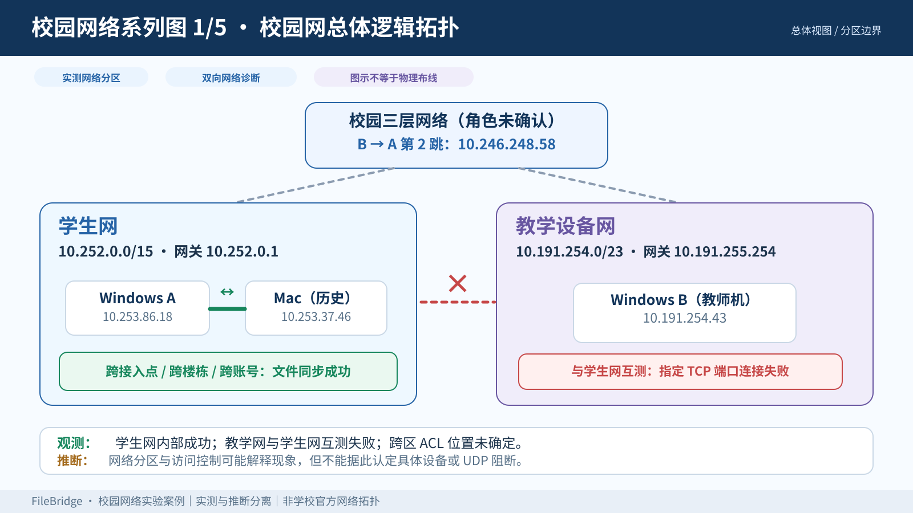
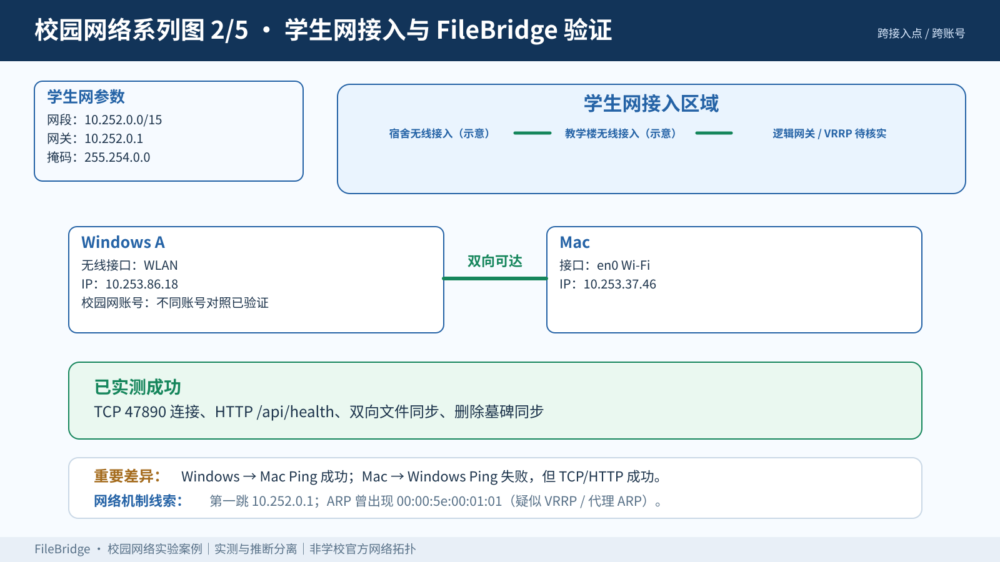
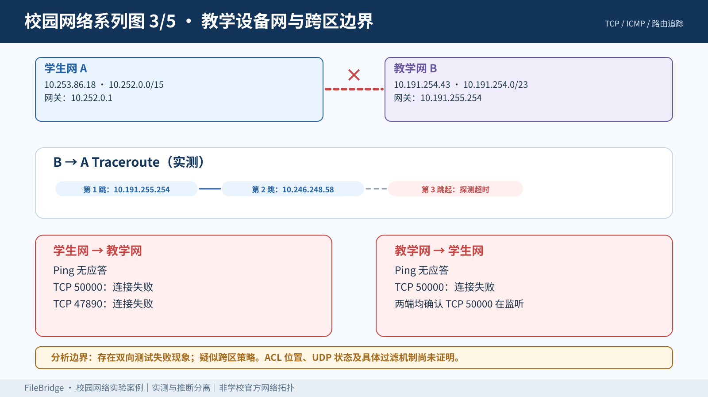
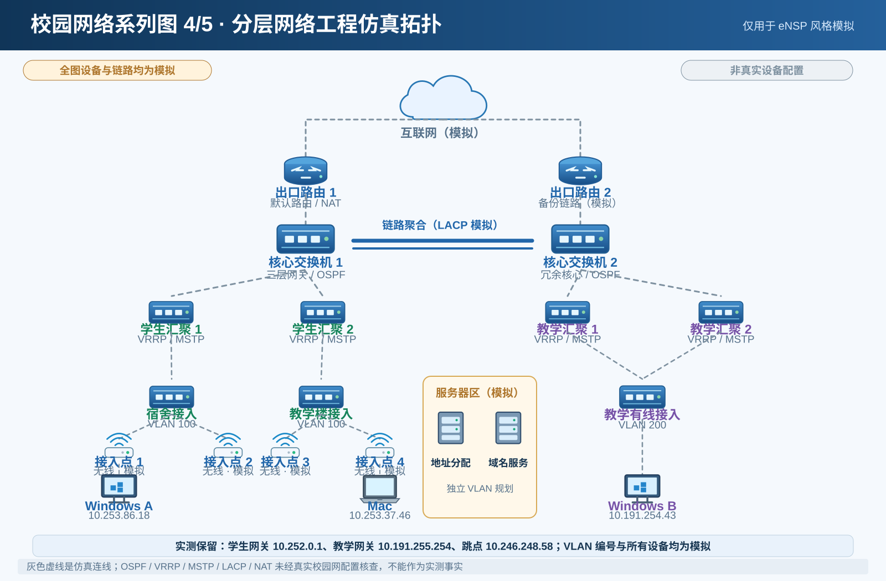
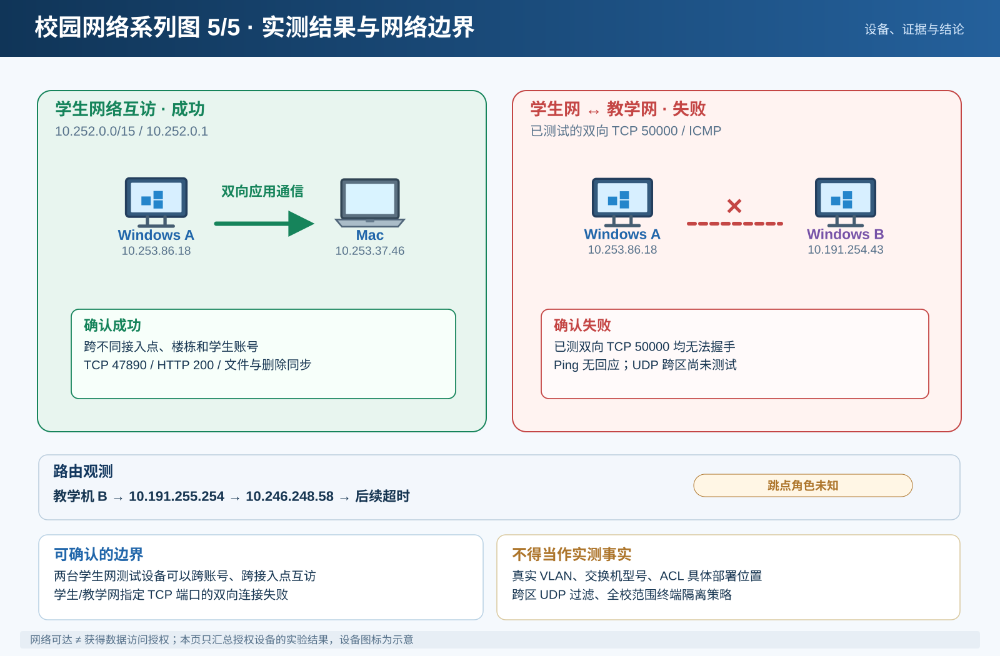
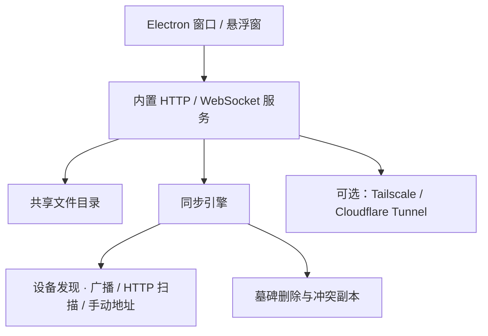

<div align="center">



# FileBridge

**Mac ↔ Windows 文件互传与双向同步**

无需云端中转 · 局域网设备发现 · 桌面拖拽投递 · iPhone 浏览器访问

[查看安装说明](docs/getting-started.md) · [了解技术架构](docs/architecture.md) · [校园网实测图集](docs/campus-network/README.md) · [连通性诊断](docs/network-validation.md)

</div>

---

## 简介

FileBridge 是面向 macOS、Windows 和手机浏览器的轻量级本地文件协作工具。两台电脑在**网络允许直接连接**的前提下，可自动发现对端并同步共享目录；遇到禁止广播、不同子网等情况时，也支持网络扫描或手动指定 IP。

> 当前版本：**v1.0.0**。项目为个人开发与实验用途，安装包尚未签名。**局域网互通取决于网络策略**，不保证任意校园网或企业网络都能直接连接。

## 核心功能

| 功能 | 说明 |
|:---|:---|
| **双向文件同步** | 自动拉取对端文件清单，下载新增或变更内容 |
| **删除墓碑机制** | 应用内删除产生墓碑并传播，避免旧副本被重新拉回 |
| **拖拽投递** | 桌面悬浮窗快速接收文件 |
| **手机浏览器访问** | iPhone Safari 扫码浏览、上传和下载，无需安装 App |
| **实时剪贴板** | 文本内容跨设备同步 |
| **文件预览** | 图片、文本、PDF、音视频及部分 Office/ZIP 预览 |
| **多种发现方式** | UDP 广播、同网段 HTTP 扫描、手动添加、IP 变更通告 |
| **远程网络扩展** | 可配合 Tailscale 或 Cloudflare Tunnel 使用 |

## 30 秒了解工作方式



- **TCP 47890**：HTTP API、WebSocket、文件传输与同步。
- **UDP 47891**：同一可达广播环境中的设备发现。
- 实际端口可能因占用而自动改变；以应用显示的端口为准。
- 同步轮询与事件触发共同工作，属于**近实时同步**，不承诺零延迟。

## 下载与运行

**查看 [Releases 发布页](https://github.com/BOLI-LEO/filebridge/releases)** 获取可用的构建包（以发布页实际提供内容为准）。

| 平台 | 安装选项 |
|---|---|
| macOS | `.pkg` / Apple Silicon `.dmg` |
| Windows | NSIS `.exe` / 免安装压缩包 |
| 手机 | 无独立 App；通过浏览器连接电脑 |

源码运行与构建需要 Node.js 22.12.0 或更高版本（建议 Node.js 22 LTS）：

```bash
npm install
npm start
# 仅运行浏览器服务：
npm run server
```

首次使用：两台电脑分别设置相同的访问口令、选择各自共享目录，然后等待设备发现；如无法自动发现，可在「同步设备」中扫描或手动添加对端 `IP:47890`。详细步骤见 [快速开始](docs/getting-started.md)。

## 校园网实测 · 五张网络系列图

本项目通过自有及获授权的设备测试了学生网内部的跨 AP、跨楼栋、跨不同合法账号互访，以及学生网络和教学设备网络间指定端口的连接表现。下面是**根据实验重新绘制的 SVG 网络图解**；并非学校官方拓扑，也不是原始 PNG 图的逐像素复制。

[](docs/campus-network/README.md)

| 学生网互通 | 教学网跨区边界 |
|:---:|:---:|
| [](docs/campus-network/README.md#02--学生网接入与-filebridge-互通) | [](docs/campus-network/README.md#03--教学设备网与跨区边界) |
| 仿真协议架构 | 测试结论 |
| [](docs/campus-network/README.md#04--网络工程仿真与协议分层) | [](docs/campus-network/README.md#05--实测结论与使用建议) |

**实验中可确认的情况：** 学生网内多地点、不同账号的测试终端可以通过 TCP/HTTP 互访并完成 FileBridge 双向同步；学生网与教学设备网之间的已测 TCP 50000 双向连接失败。核心/汇聚的实际设备、ACL 部署位置、VLAN 编号和跨区 UDP 策略**均未证实**。

[查看完整图集、地址表与证据边界 →](docs/campus-network/README.md)

## 架构与实现



**删除语义必须注意：** 仅在 FileBridge 内删除才会生成墓碑并同步删除；直接在文件管理器中删除可能被对端重新同步回来。应用内删除目前是永久删除，不进入回收站。两端修改同名文件时保留冲突副本，避免简单覆盖。

**安全边界：** FileBridge 默认使用明文 HTTP；局域网不等于可信网络。使用访问口令，仅共享预期目录；跨公网请采用安全隧道并增加额外认证。不要将访问口令放在截图、文档或 Git 提交中。

## 文档导航

| 指南 | 说明 |
|---|---|
| [安装与首次运行](docs/getting-started.md) | Mac、Windows、手机端操作 |
| [技术架构](docs/architecture.md) | 内置服务、同步流程和端口 |
| [同步协议](docs/sync-protocol.md) | 设备发现、增量同步、冲突和墓碑 |
| [HTTP API](docs/API.md) | 服务接口与身份认证 |
| [Windows 部署](docs/windows-deployment.md) | 安装、权限和常见问题 |
| [网络连通性诊断](docs/network-validation.md) | ICMP、TCP、HTTP 的排障方法 |
| [校园网络实验图集](docs/campus-network/README.md) | 五张矢量拓扑图、测量事实与推断 |
| [故障排查](docs/troubleshooting.md) | 连接、安装、同步问题 |
| [变更日志](CHANGELOG.md) | 版本记录 |

## 许可

[MIT License](LICENSE)。
