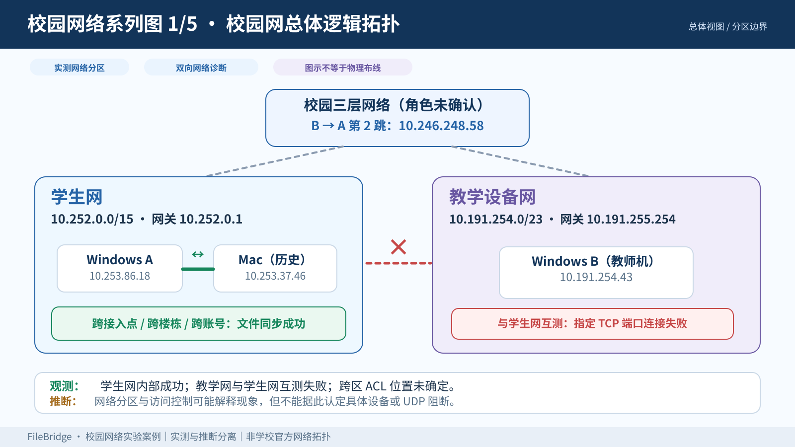
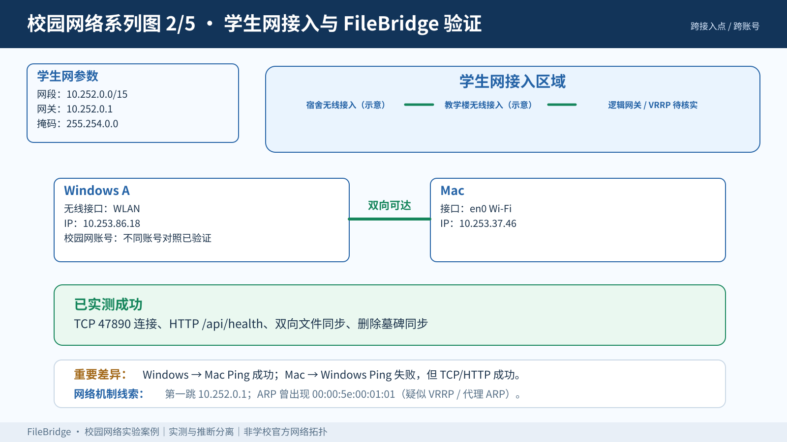
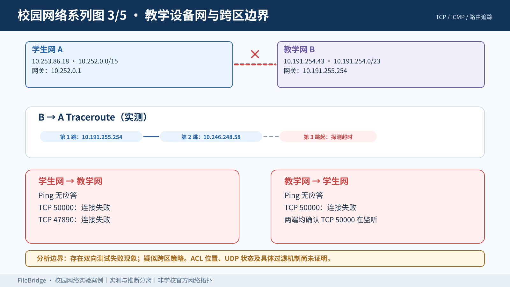
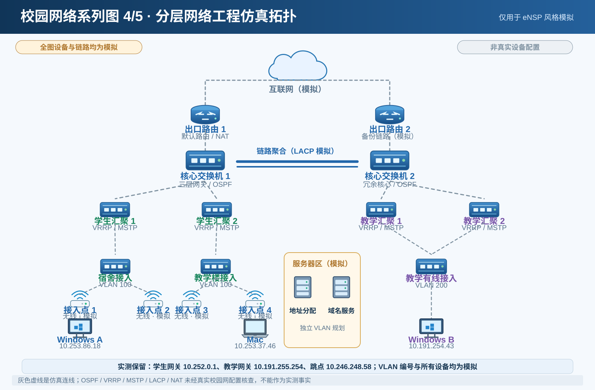
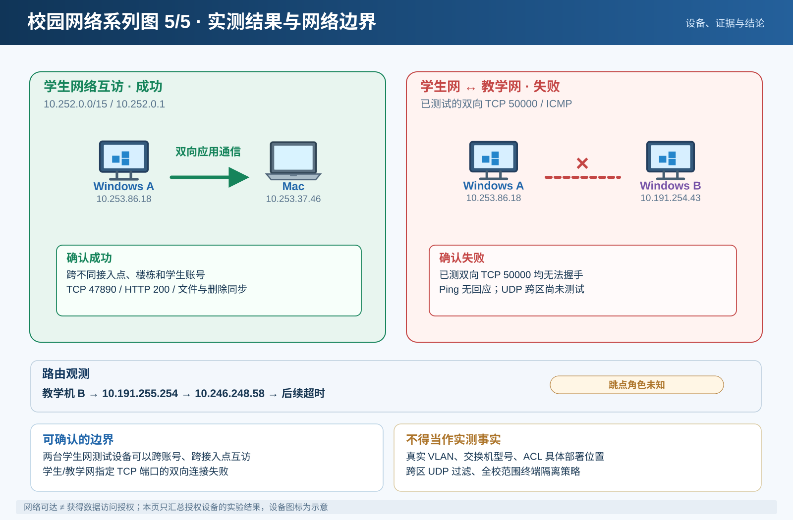

# 校园网网络实验与拓扑图集

> 这是 **FileBridge 的实际网络连通性案例**。本目录的 **5 张 SVG 图为根据测量记录重新绘制的技术图解**，并非原先 AI 生成的 PNG 图片，也不代表学校的官方网络拓扑。凡是交换机、接入点数量、VLAN 编号、VRRP / OSPF / ACL 部署位置等未经观测的内容，都只能作为 **仿真设计或推断**。

[← 返回 FileBridge 首页](../../README.md) · [连通性排查](../network-validation.md) · [协议架构](../architecture.md)

## 五张系列图

### 01 · 校园网总体逻辑拓扑

该图汇总学生网与教学设备网的已知 IP 子网、网关、已观察三层跳点、已测通信结果，灰色虚线只表达推断或不完整观测。互联网出口与核心设备的实物连接方式未知。

### 02 · 学生网接入与 FileBridge 互通

实验期间，Windows A（`10.253.86.18`）和 Mac（`10.253.37.46`）位于学生网 `10.252.0.0/15`，跨 AP、跨区域可以完成 TCP 47890、HTTP `/api/health` 与文件同步；不同合法学生认证账号的互访对照也已完成。

### 03 · 教学设备网与跨区边界

学生终端 `10.253.86.18` 与教师机 `10.191.254.43` 的已测双向 TCP 50000 连接失败，ICMP Echo 未收到响应。教师机到学生网的 traceroute 曾观测到 `10.191.255.254`、`10.246.248.58`，随后探测超时。**超时不等于已经锁定 ACL 所在设备**。

### 04 · 网络工程仿真与协议分层

此页展示 eNSP 风格的**模拟方案**，包括双核心、汇聚、VLAN、MSTP、VRRP、OSPF、Eth-Trunk/LACP、NAT 等可选机制。这些不是学校真实配置的证据，也不意味着所有机制已经在真实校园网上测出。

### 05 · 实测结论与使用建议

通过同账号 / 不同账号的学生网测试、跨区域通信以及教学网双向连接测试，把可确认事实与可能的 ACL 等解释分开。

## 已观测的网络参数

| 区域 / 终端 | 地址或子网 | 网关 / 说明 |
|---|---|---|
| 学生网络 | `10.252.0.0/15` | `10.252.0.1` |
| Windows A | `10.253.86.18` | WLAN |
| Mac | `10.253.37.46` | Wi-Fi / en0 |
| 教学设备网 | `10.191.254.0/23` | `10.191.255.254` |
| Windows B（教师机） | `10.191.254.43` | 以太网 |
| 观测到的三层跳点 | `10.246.248.58` | B→A 路径中的第 2 跳；设备角色未确认 |
| ARP 观测值 | `00:00:5e:00:01:01` | 符合 VRRP 虚拟 MAC 格式，Proxy ARP 仍为推断 |

## 实测结论与可证实范围

| 测试 | 实测结果 | 解释边界 |
|---|---|---|
| 学生网内跨 AP、跨楼栋 | 成功 | 仅覆盖已测区域 |
| 不同合法学生账号的个人电脑 | 成功互访 | 不代表所有账号或所有网络区域 |
| FileBridge TCP 47890 与 HTTP | 成功 | 表明测试终端可以建立应用层连接 |
| 文件上传下载、同步和删除同步 | 成功 | 同步在 FileBridge 授权共享目录内完成 |
| Windows A→Mac Ping | 成功 | 此次 ICMP 可用 |
| Mac→Windows A Ping | 无响应 | TCP / HTTP 同时成功，不能单以 Ping 判定服务不可达 |
| Windows B→A 路由跟踪 | 网关 `10.191.255.254` → `10.246.248.58` → 超时 | 后续路径及过滤位置未知 |
| A↔B TCP 50000 | 双向失败 | A、B 均确认监听，且记录过对应放行规则；仍不能单独锁定 ACL |
| 跨学生网与教学网 UDP | **未测** | 不能声称 UDP 已被阻断 |

## 对 FileBridge 的意义

- **两端均位于已验证可达的学生网范围：** 不同 AP、不同学生账号也能使用 TCP/HTTP 同步，不依赖云端中继。
- **跨学生网与教学设备网：** 所测端口双向不通。网络区域访问策略需要学校网络管理方确认，不能把失败直接归因于 FileBridge。
- **自动发现与实际文件传输是两种测试：** UDP 47891 用于设备发现；真正的文件传输通过 TCP 47890 / HTTP 完成。扫描、手动添加记录和发现广播的影响应分别辨别。

## 仿真与正式网络的边界

**实测：** 子网地址、网关、终端 IP、特定 TCP/ICMP 测试结果、观测到的 traceroute 跳点、FileBridge 同步表现。

**未证实：** 真实 VLAN 编号、交换机与出口设备型号、物理接口与布线、OSPF / MSTP / LACP 等协议是否运行、ACL 的具体规则及安装位置、跨区 UDP 结论、全校覆盖率。

网络可达不等于已经获得设备访问授权。该案例仅记录自有或经授权设备的测试。
